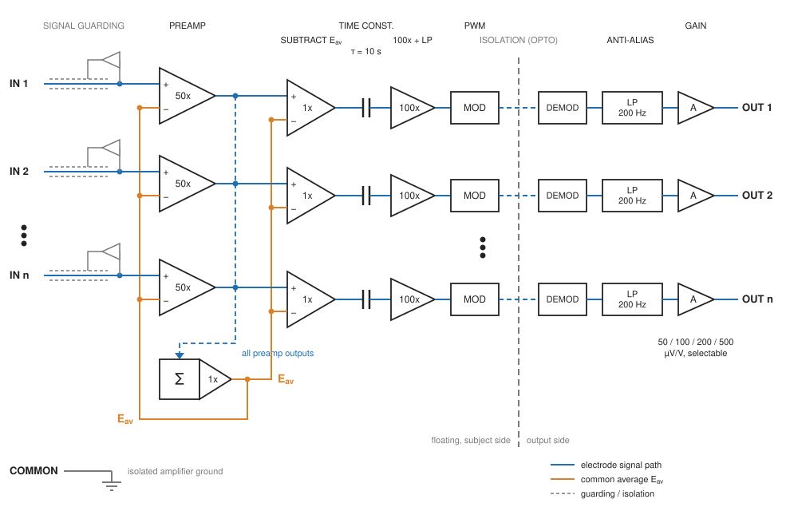

# The TMSi reference amplifier input topology

The TMSi reference amplifiers use an EEG input stage built around a **common average** that is computed in hardware and fed back into every preamplifier. This document describes that stage. The definitive source is:

> Clots, J.P., Mulder, L.J.M., & Hoekstra, E. *A PC-based physiological measurement and data acquisition system.* (Chapter 2, University of Groningen, Experimental and Occupational Psychology.)

The principle itself goes back to Vos, Lammertsma, & van Eykern (1977), cited in that chapter.

## The conventional approach and its problem

Many amplifiers measure each channel relative to a single **reference electrode** (mastoid, ear lobe, nose, Cz). Every channel then sees:

> output = E_i - E_reference

The quality of every channel depends on that one electrode. If it has a high impedance, sits in a noisy location, or picks up an artifact, all channels are affected.

## The common average (CA) principle

In common average mode the amplifier does not use a reference electrode. Per the block diagram of the EEG channels:

1. Each electrode input **IN i** drives the **+ input** of its own **50x preamplifier**.
2. The outputs of all *connected* preamplifiers are combined in a **summing/averaging stage (Σ) followed by a 1x buffer**. Its output is the average, **E_av**. This is an active circuit, not a passive resistor network.
3. E_av is **fed back to the - input of every preamplifier**. As a result only the electrode input voltage is amplified; the signal common to all electrodes is not.
4. E_av is also fed to the **- input of a 1x differential stage** behind each preamplifier, which subtracts the common signal from that preamplifier's output.

Each channel therefore delivers the derivation:

> E_i - E_av

where E_i is the voltage at input i and E_av is the average of all connected inputs. The paper calls this the **common average (CA)** derivation.

*Blue: electrode signal path. IN 1 ... IN n each drive the + input of a 50x preamplifier through a guarded (actively shielded) lead. The dashed blue bus collects all preamplifier outputs, which are averaged by Σ and buffered (1x). Orange: the resulting E_av is fed back to the - input of every preamplifier and to the - input of each 1x differential stage, whose output is E_i - E_av. Each channel then passes the 10 s time constant, the 100x amplifier with low-pass, the pulse width modulator, the optical isolation barrier, the demodulator, the 200 Hz anti-alias filter and the gain stage. A separate COMMON electrode connects the subject to the isolated amplifier ground. Redrawn after the EEG block diagram in Clots, Mulder & Hoekstra.*

> Note: the original figure captions in the paper are swapped. The diagram with IN 1 ... IN n, Σ and E_av (printed as "Figure 1b") is the EEG channel diagram.

## The remainder of the EEG signal chain

After the common average stage, each EEG channel passes through:

| Stage | Function |
|---|---|
| Time constant (τ = 10 s) | High-pass coupling that removes offset voltages, mainly the already amplified electrode-potential differences. Can be "deblocked" (reset). |
| 100x amplifier + low-pass filter | Further amplification. |
| Modulator | Pulse width modulation of the signal. |
| Optical isolation | The modulated, now digital, signal crosses the galvanic separation optically. |
| Demodulator + 200 Hz low-pass | Butterworth low-pass, -40 dB at 500 Hz; doubles as anti-alias filter for 1000 Hz sampling. |
| Output amplifier | Selectable sensitivity of 50, 100, 200 or 500 µV/V; out-of-range indication at ±1 V. |

Sensitivity, time constant, low-pass filter and derivation are set per measurement group, not per channel.

## Why it amplifies signal but not common noise

Any voltage that appears equally on **all** connected electrodes (for example capacitively coupled mains interference) is part of E_av. Because E_av is fed back to the - inputs, that common signal is not amplified, and because it is subtracted again in the differential stage, it is removed from every output.

Formally, if a voltage N appears on all inputs:

> output_i = (E_i + N) - mean(E + N) = E_i - mean(E)

N cancels. Across all channels in CA mode the outputs sum to zero, since Σ (E_i - E_av) = 0.

DC electrode offsets are a different matter: they differ per electrode, so they are not removed by the average but by the 10 s time constant after the preamplifier.

The common average is only one part of the noise strategy. The paper lists:

- High input impedance: 10^12 Ohm.
- Low noise: 2 µV top-top.
- Common mode rejection (CMR): 110 dB at 50 Hz.
- Isolation mode rejection (IMR): 170 dB at 50 Hz.
- **Guarding** (active shielding, "bootstrapping") of the electrode leads: the input signal is driven onto the cable shield, which improves CMR for AC signals and avoids cable-movement artifacts.
- Floating measurement through galvanic separation; leakage current at 50 Hz below 5 µA.
- Compact, symmetric construction, and synchronisation of all internal oscillators to one crystal.

## The important caveat

The CA derivation cannot distinguish between shared noise and shared brain signal. Activity that is present on all connected electrodes is part of E_av and is removed along with the noise. What remains is each electrode's deviation from the average of the *connected* electrodes, so the recorded values depend on which, and how many, electrodes are plugged in. Channels whose input is not plugged in are switched off automatically and do not contribute to the average.

## Common reference (CR) mode

The common average is not the only derivation. The amplifier can also run in **common reference (CR)** mode:

- The first channel (in CA mode) is subtracted from the other channels using differential amplifiers, so channel 1 acts as the reference. Typically an ear lobe or mastoid electrode is connected there.
- For a linked-ears style reference, the basic unit can instead use the average of the **first two channels** as the reference.

If all channels are recorded in the same derivation mode, any other derivation between channels can be made afterwards, either with external differential amplifiers or by on-line or off-line computation.

## Why the montage matters

The electrode cables plug into numbered inputs, and the researcher decides which input receives which cap electrode. Charmeleon must therefore be told the mapping ("input 7 is Fz") before it can display the correct electrode names. This is what the montage file stores. See the [montage tutorial in the main README](../README.md#tutorial-setting-up-a-tmsi-refa-montage).
